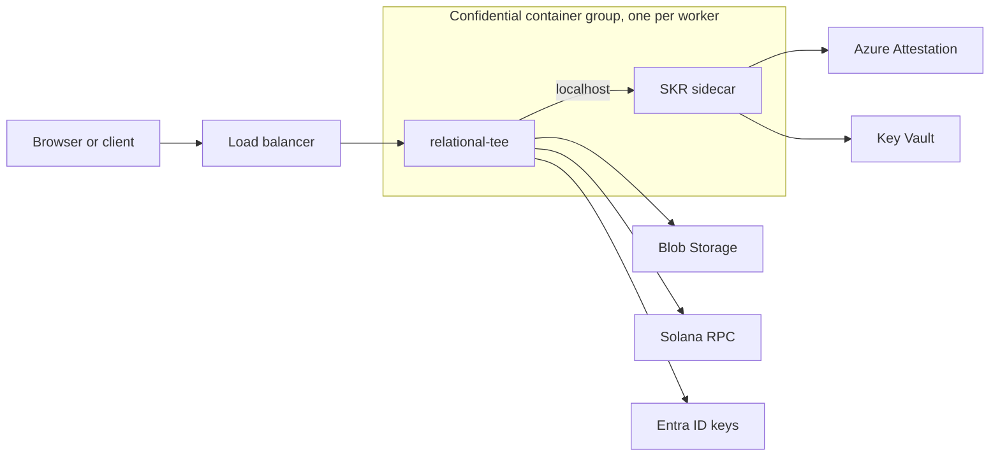

# Architecture

Every worker runs in its own confidential container group, beside Microsoft's SKR sidecar, behind a layer-4 load balancer. Workers share nothing but Blob Storage and the chain, and any worker can serve any request.

## Keys

At startup the worker obtains four P-256 keys, `transport-key`, `storage-root`, `tls-key` and `commitment-key`, and keeps them in memory only. Release builds get them from Microsoft's SKR sidecar on localhost (`KEY_PROVIDER=skr`), which releases a key only to a confidential container group whose attested policy matches the key's release policy. Dev builds default to `KEY_PROVIDER=local`, which reads dev keys from `dev/keys/` (`just dev-keys` creates them); release builds don't contain that provider and refuse `KEY_PROVIDER=local`.

Uploads are sealed to `transport-key`, which every worker shares.

Besides its current version, a worker opens uploads sealed to any version the reference-values manifest lists with a Key Vault `version`: it releases that version through its key provider (as `transport-key/{version}`), checks that its thumbprint is the listed `kid`, and drops it once a manifest no longer lists it. During a rotation the manifest lists both versions, so every worker opens uploads sealed to either, whichever it started with; the old one stops opening when CD publishes the manifest that retires it, after its 24-hour soak. `KEY_PROVIDER=local` and the fake sidecar know one other version, `previous` (`transport-key.previous.jwk`).

## TLS

The worker serves HTTPS (TLS 1.3, rustls with aws-lc-rs) with `tls-key`, which is released only to attested workers and never written anywhere. Its certificate chain is `{spki_sha256}/chain.pem` in the `tls` container, which isn't sealed because chains and CSRs hold nothing secret, where `spki_sha256` is the hex SHA-256 of the key's SubjectPublicKeyInfo, so clients can pin the key across renewals.

While there's no chain, any worker writes a CSR for `API_HOSTNAME`, signed with `tls-key`, to `{spki_sha256}/csr.pem`, create-only, for the certificate job to sign; workers look for the chain every 10 seconds until they have one, then every 5 minutes, and swap renewals in without a restart.

A chain whose leaf isn't `tls-key`'s is ignored and logged with `alert = "tls_chain_mismatch"`, and one a client would refuse now, checked by rustls's own server certificate verifier against Mozilla's roots (expired or not yet valid, for another hostname, not for serving TLS, or not chaining to a trusted root), with `alert = "tls_chain_invalid"`; either way the chain already served stays.

Readiness requires a loaded, unexpired chain, and a served chain that expires with no valid replacement logs `alert = "tls_chain_expired"` at each check. Release builds have no plain HTTP path; for dev builds, see [Local HTTPS](development.md#local-https).

## Authentication

Protected endpoints take Entra ID access tokens for the worker's API app registration. A token must be RS256, signed by a key from the pinned tenant's JWKS, with that tenant's exact `iss` and `tid`, the API's client ID as `aud`, an allowed client as `azp`, and `access_as_user` in `scp`; `exp` and `nbf` allow 60 seconds of skew. jsonwebtoken verifies RS256 through aws-lc-rs, so the `rsa` crate stays out.

The JWKS (`https://login.microsoftonline.com/{tid}/discovery/v2.0/keys`) is cached for 24 hours and refetched for an unknown `kid` at most once a minute; one fetch runs at a time and answers every request waiting for it, failed or not, a failed fetch is retried after 5 seconds, doubling to 5 minutes, and while fetches fail the keys held keep verifying tokens for up to 72 hours after the last fetch that worked.

A caller's `(tid, oid)` maps to an internal `user_id`, created at their first sign-in or when an admin registers them beforehand; every stored reference to a person uses it.

The `Admin` app role grants the permissions `pools:read`, `pools:create`, `pools:write`, `wallets:read`, `users:read` and `analyses:run`, and is itself required for wallet creation, deletion and sends and for `/v1/admin/…`; every other signed-in caller gets only `analyses:run`, which runs the analyses their grants allow (`GET /v1/drt/me/analyses` lists them), so no app role is needed to be an analyst; the pool list needs `pools:read`. Pool writes also need pool ownership, and wallet routes wallet ownership. The worker reads no `groups` claim: the rows an analyst sees come from their grant (see [Analyses](analyses.md)).

Dev builds also accept tokens signed with a local dev key; see [Calling the API](development.md#calling-the-api).

## Grant commitments

An issuance burns an append DRT into a Grant PDA derived from its commitment: HMAC-SHA256 over the issuance's record ID, the pool UUID and the append DRT's right ID, under a key derived from `commitment-key` with HKDF-SHA256 (salt `relational-tee/commitment`, info `k-commit-v1`). Only a worker holds that key, so only a worker can tell which Grant PDA belongs to which record. `commitment-key` never changes within an environment, because every Grant PDA depends on it. A retried issuance burns under the commitment its first attempt staged. An analyst's grant burns one of the pool's Execute DRTs the same way, under the commitment of the analyst's `user_id` to the analysis's right ID, so every grant of one analyst to one analysis has the same Grant PDA, and revoking the grant closes it.

## Storage

All durable state lives in Azure Blob Storage as documents sealed inside the worker with a key derived from `storage-root`; workers keep nothing on local disk. Dev builds default to the same sealed objects in local files under `./data`.

Everything durable is an object in one store with four operations: get (conditional on a cached ETag), create-only put, compare-and-swap put, and list. There's no delete or append. `AzureBlob` implements it with three Blob REST calls over the worker's own hyper and rustls client, authenticated with Entra tokens from the managed identity endpoint (the account has shared keys disabled). A token is replaced in the background from 5 minutes before it expires, and used until a minute before; one fetch runs at a time and answers every request waiting for it, and a failed fetch is retried after 1 second, doubling to a minute; `LocalFiles` implements it on local files for development and tests. One conformance suite runs against both.

### Sealing

Every object in the `state` container is sealed inside the worker: `"RTS1"` ‖ a random 96-bit nonce ‖ AES-256-GCM ciphertext, under `storage-key-v1`, with associated data binding the container and path, so a moved or copied object fails to open. `storage-key-v1` and `index-hmac-v1` are HKDF-SHA256 over `storage-root`'s private scalar, salt `relational-tee/storage-root`. `index-hmac-v1` names identity objects, so Entra object IDs and emails never appear in object names.

### Layout

- `pools/{pda}.json` is one document per pool: its metadata, schema, who created it with the creation signature, the initial upload, the issuance log with each burn's signature, the revocations, the analysts' grants with their burn and close signatures, and its generation, with the transaction that anchors it while that may not have landed (see [Analyses](analyses.md)). That document is the pool's audit trail, and its totals are computed from it.
- `pools/{pda}/datasets/{upload_id}` holds each uploaded CSV, create-only.
- `wallets/{id}.json` and `wallets/{id}/keypair` hold a wallet, and `owners/{user_id}.json` points each user at their one wallet.
- `identities/…` map Entra identities to internal user IDs.
- `scripts/{sha256}` holds each analysis definition a pool was created with, under its hash, which every read checks again.
- `chain/grants/{pda}.json` keeps what the chain last showed at each of the pool's Grant PDAs and at its counter.
- `audit/analyses/{pda}/{date}/{event_id}.json` records each analysis request, create-only.
- `idempotency/{user_id}/{hash}.json` holds each idempotent request's record (see [Idempotency](api.md#idempotency)).
- `staged/{op_id}.json` holds what a pool creation, issuance or grant will write, staged before its transaction is sent, until a storage lifecycle rule deletes it 8 days later, a day after its request's record.
- `receipts/{seed}.json` records each transfer's receipt until its deposit is swept back.
- `canary/{worker_id}` is the readiness canary.

The worker creates the `state`, `tls` and `reference-values` containers at startup if they're missing. `STORAGE_BACKEND=azurite` signs with Azurite's well-known dev account key (dev builds only).

### Writes

Every write is create-only or a compare-and-swap, so no worker needs a lock. A lost compare-and-swap retries three times with jitter, then the request fails with `409 conflict`.

### The reconciler

Every worker lists `staged/` every 5 minutes. For each saga older than 10 minutes whose effect is on chain at `finalized` (the pool account, or the issuance's or grant's Grant PDA) but missing from its document, it writes the pool document or adds the issuance or grant entry, with the signature from the saga's idempotency record. So a request that died after its transaction, and was never retried, still lands in the documents. A grant revoked after the saga was staged wins: the reconciler never restores access. It never deletes or undoes anything, and running it on every worker at once is safe. The same pass returns transfer receipts' deposits to their wallets, a transaction for each few, once a receipt is 8 days old and its request's idempotency record is gone, and finishes the anchors of pools still settling.

### The cache

Each worker keeps decrypted objects of up to 1 MiB in an LRU with their ETags, bounded at 4,096 objects and 64 MiB. A read sends the cached ETag and costs no body or decryption when nothing changed; a list returns every ETag, so only changed objects are fetched. Keypairs are never revalidated. Datasets bypass this cache: analyses keep their own (see [Analyses](analyses.md#how-it-runs)).

### Wallet history

Wallet history isn't stored: it's read from Solana on demand (`getSignaturesForAddress`, then `getTransaction`), with SOL amounts from balance changes and SPL amounts from token-balance changes. Its cursor is the last signature of the previous page. Each worker caches pages for 30 seconds and parsed transactions by signature.

### Pagination

Lists are filtered, sorted and paged in memory. A cursor is the key of the previous page's last item, so any worker continues it; one that names no item returns `400 invalid_cursor`. Lists don't take `offset` or return totals.

## Health and shutdown

`GET /health/ready` answers 200 only when the worker holds its four keys, has a valid certificate (or serves plain HTTP in a dev build), its storage canary (a read and a conditional write of the sealed `state/canary/{worker_id}`, every 20 seconds) succeeded within 60 seconds, and it isn't draining. It reads cached state only and never depends on Solana RPC.

On SIGTERM the worker fails readiness at once, keeps serving for 10 seconds so the load balancer notices, then stops accepting connections and gives in-flight requests up to 40 seconds, and blocking work still running 5 more; Ctrl-C skips the 10 seconds, and a second Ctrl-C exits at once.

A background task (the canary, the RPC check, the reconciler, the certificate, reference-values and attestation refreshes, and the rate limiters' cleanup) that stops or panics is started again, after a pause that grows while it keeps failing, and logs an error with `alert = "background_task_stopped"`.

## Solana RPC

The public devnet RPC by default. It is rate-limited and has no SLA, and the server warns about it at startup.
